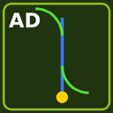

# AutoDrive Route Builder (`FS25_AutoDriveRouteBuilder`)

[Deutsch](README.md) | **English**

Builds AutoDrive routes from settings and places them with the mouse – instead of setting every waypoint by hand. The points are created with AutoDrive's own functions and sent to everybody in multiplayer.

## What it looks like

**Put bays into a bunker silo automatically** – mouse into the silo, Num9, done:

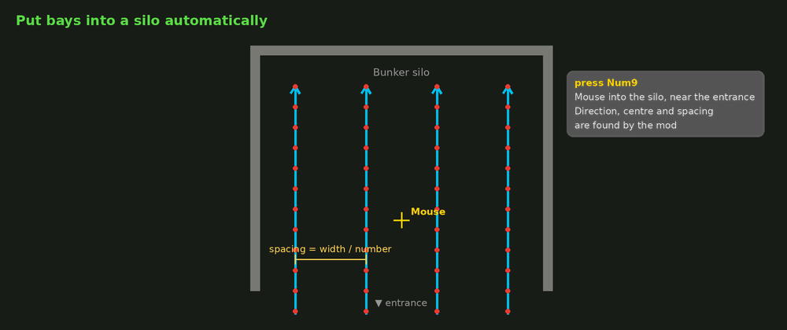

**Approach along a guide line** – the radius stays, the point where it joins the bay is computed:

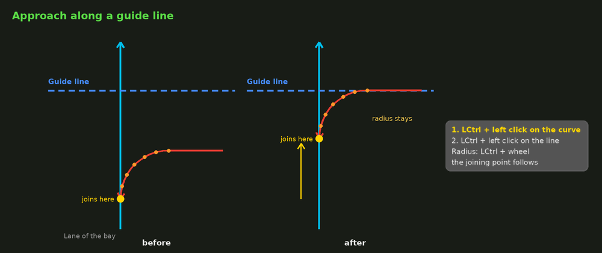

## Requirements

- Farming Simulator 25
- [FS25_AutoDrive](https://github.com/Stephan-S/FS25_AutoDrive) (developed with AutoDrive 3.0.1.4)
- Multiplayer / dedicated server: install it on the server **and** on all players in the same version.

## Installation

1. Download the zip file from the [releases](../../releases) (do not unpack it).
2. Put it into the mods folder, e.g. `Documents/My Games/FarmingSimulator2025/mods`.
3. Activate it together with AutoDrive when loading the savegame.

Build it yourself: zip `modDesc.xml`, `icon_*.dds` and the folders `scripts` and `gui` – `modDesc.xml` has to be directly in the zip file. The folder `docs` does not belong into the mod.

Also by me: [AutoDrive Jobs (FS25_AutoDriveJobs)](https://github.com/Toneslin-incarna-gaming/FS25_AutoDriveJobs).

## Contents

- [Getting started](#getting-started)
- [Build types](#build-types)
- [Keys while placing](#keys-while-placing)
- [Guide lines](#guide-lines)
- [Aligning a branch / merge to guide lines](#aligning-a-branch--merge-to-guide-lines)
- [Selecting, moving, copying, deleting AutoDrive points](#selecting-moving-copying-deleting-autodrive-points)
- [Top view and editing AutoDrive](#top-view-and-editing-autodrive)
- [Good to know](#good-to-know)
- [Support](#support)

## Getting started

1. **LCtrl + LAlt + B** starts the builder – in the top view and with the build type **guide line**.
2. **Num1** opens the build type menu, a number or a click chooses the type.
3. **LCtrl + LAlt + B** again opens the **settings of the build type you are using** (explanation on the right, diagram below). "Place" or "Back" returns to the same place.
4. **Left click** builds. The builder stays active, so you can go on building.
5. **End** closes the builder.

**LCtrl + LAlt + P** starts placing directly with the last values. **LCtrl + LAlt + Z** undoes the last route.

While placing, a panel at the top left shows the current values and all keys of the build type (**Num-** collapses it).

## Build types

While placing, **Num1** opens a menu with all build types – press the number or click it.

| No. | Build type | What it builds |
|---|---|---|
| 1 | **Reverse bay** | One or more bays side by side (silo, parking, unloading): forward in to the turning piece, reverse into the target, forward out via the exit. With AD targets (target name + running number) and collector roads for several bays. |
| 2 | **Free curve** | A curve from the mouse position with side, angle, radius and number of points. |
| 3 | **Guide line / cross** | A line with a cross line and a ruler for aligning. Only you see it, nothing is built in AutoDrive. |
| 4 | **Straight on guide line** | 1st click = start, 2nd click = end, both are put onto the guide line. The points are spread evenly (spacing at most "max. point spacing"). |
| 5 | **Arc** | An arc touching the last two guide lines. The mouse chooses corner and size. |
| 6 | **Branch** | Feed line, branches to the left and/or right (each with its own angle, radius and start), optionally straight on. For merging there is the merge (7). |
| 7 | **Merge** | The counterpart: lines from behind left and/or right join into one line. |
| 8 | **Select / move** | Select existing AD points with a box, move, copy, delete them. |

| Reverse bay | Branch |
|---|---|
| 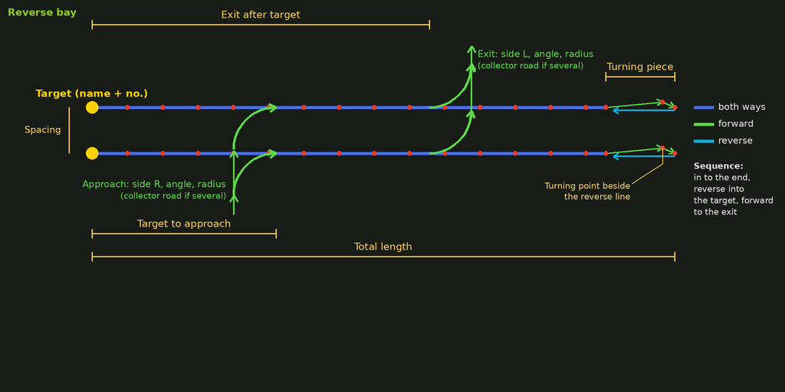 | 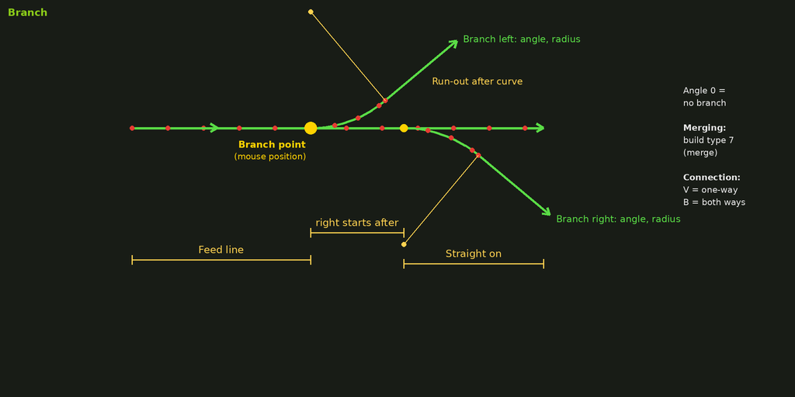 |
| **Merge** | **Free curve** |
| 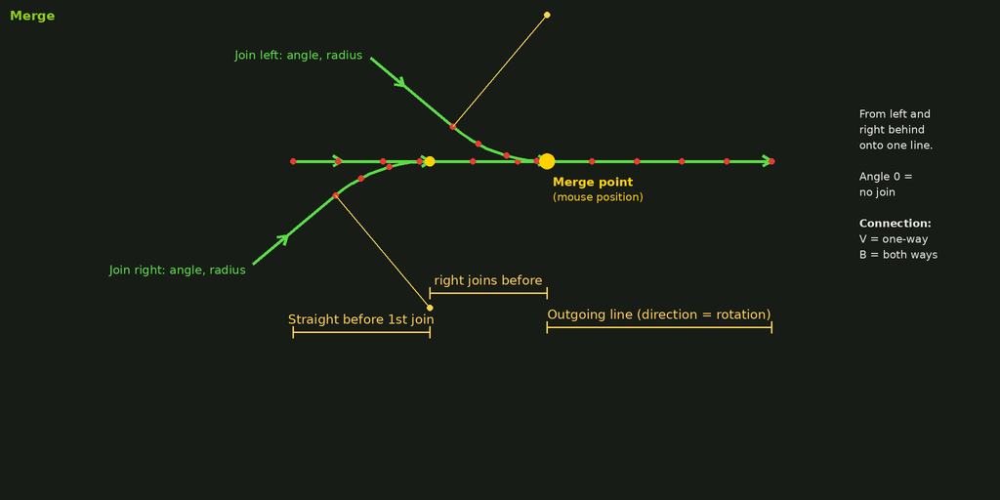 | 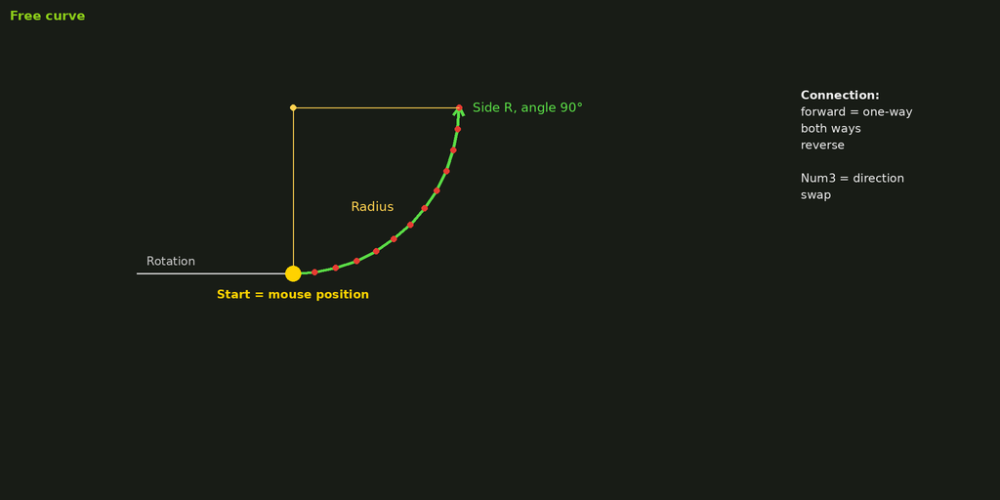 |
| **Arc** | **Guide line** |
| 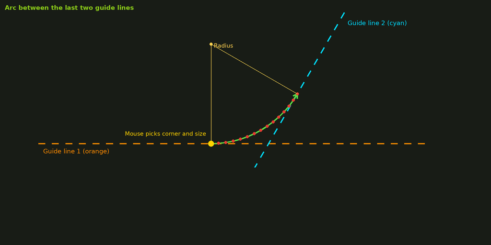 | 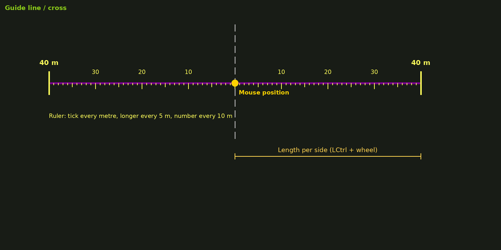 |
| **Straight on guide line** | |
| 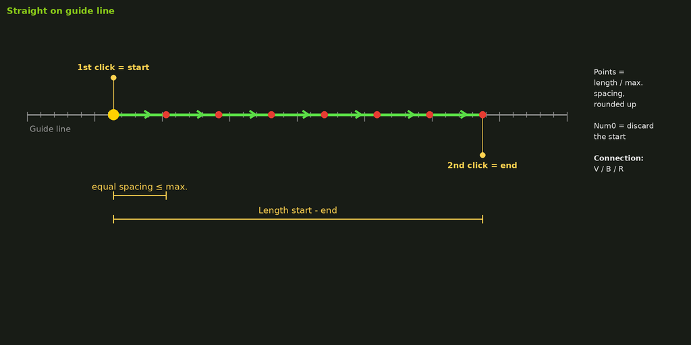 | |

**Connection types** (curve, arc, straight, branch): **V** = one-way forward, **B** = both ways, **R** = reverse.

## Keys while placing

### All build types

| Key | Function |
|---|---|
| Left click | build (stays active) |
| End | close the builder |
| short right click / Num Enter | edit AutoDrive (building paused) and back |
| Mouse wheel | camera zoom |
| hold middle mouse button / Num/ | look around |
| LShift + wheel or `,` / `.` | rotate in 5° steps |
| LShift + LAlt + wheel | fine rotation 0.1° (with LCtrl 0.01°) |
| Num8 / Num2 / Num4 / Num6 | fine move 0.1 m (LShift 0.01 m) |
| Num5 | lock position |
| Num0 | snap to the nearest AD point and take its direction |
| Num1 | build type menu (LShift + Num1 = previous type); a right click closes the menu without pausing building |
| LAlt + Num1 | to "straight on guide line" and back |
| H | helper circles on / off |
| Num- | help panel on / off |
| Num+ | top view on / off |
| LCtrl + Num+ | top view back above the person / vehicle, in their view direction |
| Num* | show the AutoDrive network on / off |
| Del / LShift + Del | remove the guide line near the mouse / bring it back |
| LCtrl + LAlt + Z | undo the last route (or move) |
| LCtrl + LAlt + B | settings of the current build type – afterwards it goes on at the same place |

While LShift, LCtrl or LAlt is held, the mouse wheel does not zoom.

### Per build type

| Build type | Key | Function |
|---|---|---|
| Bay | LCtrl + wheel | radius of approach and exit (LShift = fine) |
| Bay | LAlt + wheel | points of the curves |
| | LCtrl + side button / LCtrl + left click | approach or exit **tangent to a guide line**: click next to the curve first, then on the guide line. The angle follows the line, the radius stays as set, and for every bay the point where the curve joins the lane is computed so that the curve starts / ends exactly on the line. The line may lie before or behind the current curve. **LCtrl + Num0** = off. |
| | LAlt + left click | on the approach or exit: this curve goes to the other side |
| | LCtrl + wheel (curve aligned) | radius of the aligned curve – the joining point on the lane follows, the curve stays on the guide line |
| | Num9 | **fit to a bunker silo automatically:** mouse into the silo near the entrance, Num9 – direction along the silo, bays centred, spacing = silo width / number, targets 2 m in front of the back wall. Then fine tune with Num8/2/4/6 and left click. |
| | Num3 | reference point: mouse = first bay or middle of all bays (centre them in a silo; spacing = silo width / number). With a fixed position (e.g. after Num9) the bays stay where they are – only the reference point changes |
| Curve, arc | LCtrl + wheel | radius |
| | LAlt + wheel | points |
| | Num3 | swap driving direction |
| | Num, | change connection type |
| Guide line | LCtrl + wheel | length per side ±5 m (LShift ±1 m) |
| | LAlt + wheel | move the line sideways (parallel) – every new LAlt press changes the step: 1 m → 0.5 m → 0.1 m → 0.01 m. The first step starts exactly on the line set (or aligned to) last, the distance to it is shown. |
| Straight | left click, left click | start, end |
| | LAlt + wheel | max. point spacing |
| | Num0 | discard the start |
| Branch, merge | LCtrl + wheel | both radii |
| | LAlt + wheel | points per curve |
| | Num, | one-way / both ways |
| | Num0 | put the start (merge: end of the outgoing line) onto an AD point – it gets connected, then everything turns around this point |
| | LAlt + left click on a side | remove this branch / bring it back |
| | LCtrl + mouse button | align to a guide line (see below) |

While LCtrl or LAlt is held, a branch / merge stays where it is, so that its sides can be clicked.

## Guide lines

- Build type **Guide line / cross**: a left click sets a line with a cross line. The line has a ruler (tick every metre, longer every 5 m, distance every 10 m) and shows its length.
- The last two lines are orange and cyan – they are the base for the **arc**.
- Guide lines are saved per map and savegame and only visible to you.
- **LCtrl + side mouse button** (or LCtrl + left click) at an existing guide line (main or cross line), at a wall of a **bunker silo** (side wall = along, entrance/back = across) or at an edge of a **building** (its building / levelling areas; the edge at the mouse counts – buildings without such areas use their axes): the new line is turned parallel to it. As long as it stays parallel, a yellow measuring line and the panel show its **distance** to that line.
- **Del** removes the line near the mouse, **LShift + Del** brings it back, **LCtrl + LAlt + L** removes all.

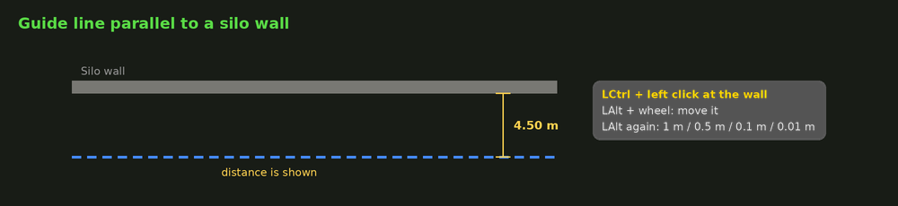

## Aligning a branch / merge to guide lines

1. **LCtrl + mouse button** next to a branch (left or right of the main line) – the side is chosen.
2. **LCtrl + mouse button** on a guide line (main or cross line). The branch gets the fitting angle and its run-out lies exactly on the line.
3. The same again for the other side.

The branch aligned **first** moves the whole branch along its axis. If the start is fixed to an AD point with Num0, the feed line gets longer instead. The **second** branch only moves where it starts on the main line. **LCtrl + Num0** switches the alignment off.

A **side button of the mouse** is used as mouse button: just press it with LCtrl while placing and the mod remembers it. The number is also shown in the settings dialog. **Without a side button** (simple mouse, touchpad) **LCtrl + left click** works everywhere as well.

## Selecting, moving, copying, deleting AutoDrive points

Build type **Select / move** – best in the top view:

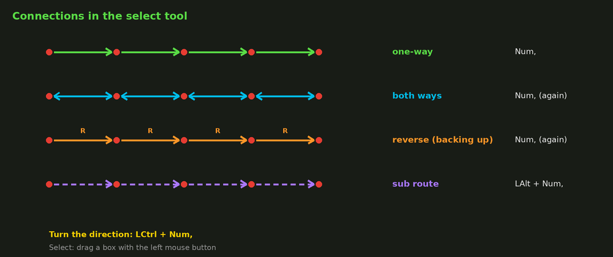

| Key | Function |
|---|---|
| drag the left mouse button | box = select points (LShift = add, LCtrl = remove) |
| click on a point | select only this one (LShift = add / remove) |
| drag a selected point | move the whole selection |
| Num3 | free / along a guide line / across it |
| Num8/2/4/6 | move the selection 0.1 m (LShift 0.01 m) |
| LCtrl + LAlt + Z | undo the last move or connection change |
| Num7 | put the selection exactly onto the guide line it lies along (main or cross line, at most 15 m away on average) – gives a clean straight |
| Num5 (exactly one point selected) | set an AD target on this point, rename it or remove it with an empty name – anywhere on the map, without driving there |
| LAlt + wheel | change the point count of a segment (curve or straight): select all its points or only the first and last one. The shape stays (curve through the old points), the end points stay, the inner points are spread anew. **left click** or **Num Enter** = apply, **Num0** = cancel. Nothing may branch off and no target may lie inside the segment. |
| Num/ (exactly two points selected) | straight line between the two points: **LAlt + wheel** = number of inner points, **Num,** = direction / both ways, **left click** or **Num Enter** = create, **Num0** = cancel. The direction goes from the end of one road to the start of the other if that is clear. |
| Num9 | like Num7 and also spread the points evenly between the two outer ones |
| LCtrl + C or Ins | copy the selection – the copy hangs on the mouse, left click pastes it (several times), rotate as while placing |
| Num, | connections of the selection: one-way → both ways → reverse → one-way (selecting only the first and last point of a route works too) |
| LCtrl + Num, | turn the direction of one-way / reverse connections around |
| LAlt + Num, | switch main / sub route (Num, = the decimal key of the numpad) |
| Del, Del again (within 3 s) | delete the selection – **cannot be undone** |
| Num0 | stop copying / clear the selection |

The connections between the selected points (with their type) and the sub route flag are copied. AD targets are not copied because AutoDrive allows every target name only once.

## Top view and editing AutoDrive

- The builder **starts in the top view** above the tractor or the person, in their view direction, **Num+** switches it off and on again: W A S D move, wheel zooms, **hold Space + drag the mouse** rotates and tilts (Home = rotate without Space). Esc or Num+ goes back.
- **Num*** shows the AutoDrive network around you, also on foot.
- **Short right click / Num Enter** pauses building and gives mouse and keys to the AutoDrive editor. AutoDrive only edits with the mouse in editor mode "extended" (**Num/** sets it), with the AD HUD shown and while you sit in a vehicle. The panel shows these states.

## Good to know

- **Multiplayer:** the mod has to be installed on the server and on all players in the same version.
- **Connecting:** a new route is only connected to the existing network where you set it with Num0. Everything else is connected in the AutoDrive editor.
- **Reverse bays:** no other road may leave from the point where reversing starts – otherwise AutoDrive does not find the way into the target any more.
- **German keyboard:** while building, "undo" takes LCtrl + LAlt + **Z** as well as **Y**. Outside the builder the game uses the key position of the US keyboard – on a German keyboard that is **LCtrl + LAlt + Y**. It can be changed in Options → Controls ("AD Route Builder: undo last route").
- Settings are saved locally in `modSettings/FS25_AutoDriveRouteBuilder.xml`.
- Texts and diagrams are available in German and English.

## Support

The mod is free. If it saves you time and you want to give something back, I am happy about a small donation – completely voluntary.

## Bugs and wishes

Please report them as an [issue](../../issues), ideally with a screenshot and the `log.txt`.

## Author

Toneslin
