# AutoDrive Strecken-Baukasten (`FS25_AutoDriveRouteBuilder`)

**Deutsch** | [English](README.en.md)

Baut AutoDrive-Strecken aus Einstellungen und platziert sie mit der Maus – statt jeden Wegpunkt einzeln zu setzen. Die Punkte werden mit AutoDrives eigenen Funktionen angelegt und im Mehrspieler an alle verteilt.

## So sieht's aus

Buchten automatisch ins Fahrsilo setzen – Maus ins Silo, Num9, fertig:

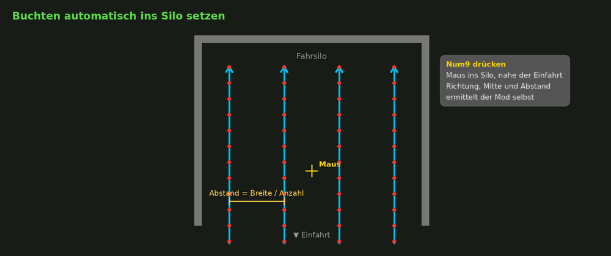

Zufahrt an eine Hilfslinie anlegen – der Radius bleibt, der Anschluss an die Bucht wird berechnet:

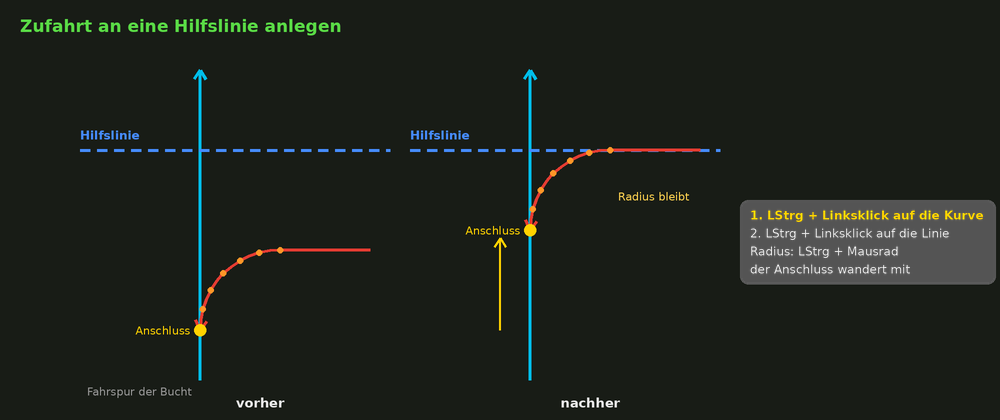

## Voraussetzungen

- Landwirtschafts-Simulator 25
- [FS25_AutoDrive](https://github.com/Stephan-S/FS25_AutoDrive) (entwickelt mit AutoDrive 3.0.1.4)
- Mehrspieler / Dedicated Server: auf dem Server **und** bei allen Spielern in derselben Version installieren.

## Installation

1. Die Zip-Datei aus den [Releases](../../releases) laden (nicht entpacken).
2. In den Mods-Ordner legen: `%USERPROFILE%\Documents\My Games\FarmingSimulator2025\mods`
3. Beim Laden des Spielstands zusammen mit AutoDrive aktivieren.

## Inhalt

- [Start](#start)
- [Bauarten](#bauarten)
- [Tasten beim Platzieren](#tasten-beim-platzieren)
- [Hilfslinien](#hilfslinien)
- [An Hilfslinien anlegen](#an-hilfslinien-anlegen)
- [AutoDrive-Punkte bearbeiten](#autodrive-punkte-bearbeiten)
- [Draufsicht und AutoDrive bearbeiten](#draufsicht-und-autodrive-bearbeiten)
- [Gut zu wissen](#gut-zu-wissen)
- [Unterstützen](#unterstützen)

## Start

1. LStrg + LAlt + B startet den Baukasten – in der Draufsicht und mit der Bauart Hilfslinie.
2. Num1 öffnet das Bauart-Menü, eine Zahl oder ein Klick wählt die Bauart.
3. Nochmal LStrg + LAlt + B öffnet die Einstellungen der Bauart, die du gerade benutzt (rechts eine Erklärung, unten ein Schaubild). „Platzieren“ oder „Zurück“ führt an dieselbe Stelle zurück.
4. Linksklick baut. Der Baukasten bleibt aktiv, du kannst gleich weiterbauen.
5. Ende beendet den Baukasten.

LStrg + LAlt + P startet das Platzieren direkt mit den zuletzt benutzten Werten. LStrg + LAlt + Z nimmt die letzte Strecke zurück.

Beim Platzieren zeigt ein Panel links oben die aktuellen Werte und alle Tasten der Bauart (Num- klappt es ein / aus).

## Bauarten

Mit Num1 öffnet sich beim Platzieren ein Menü mit allen Bauarten – Zahl drücken oder anklicken.

Verbindungsarten (Kurve, Bogen, Gerade, Verzweigung): V = Einbahn vorwärts, B = beidseitig, R = rückwärts.

### 1. Rückfahr-Bucht

Eine oder mehrere Buchten nebeneinander (Silo, Parkplatz, Abladestelle): vorwärts rein bis zum Wendestück, rückwärts ins Ziel, vorwärts über die Abfahrt raus. Mit AD-Zielen (Zielname + fortlaufende Nummer) und Sammelstraßen bei mehreren Buchten.

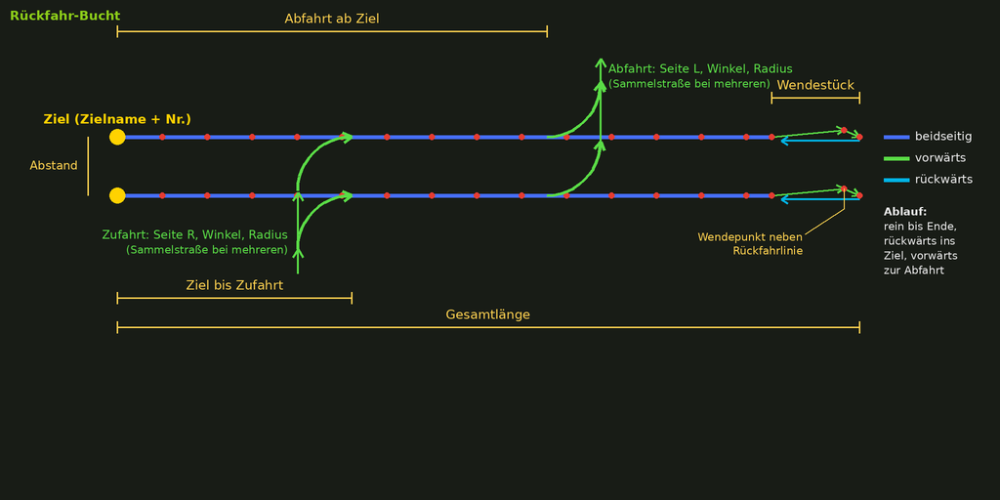

### 2. Freie Kurve

Eine Kurve ab der Mausposition mit Seite, Winkel, Radius und Punktzahl.

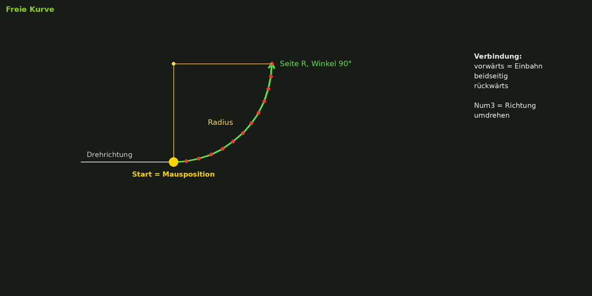

### 3. Hilfslinie / Kreuz

Eine Linie mit Querlinie und Lineal zum Ausrichten. Nur du siehst sie, AutoDrive baut nichts.

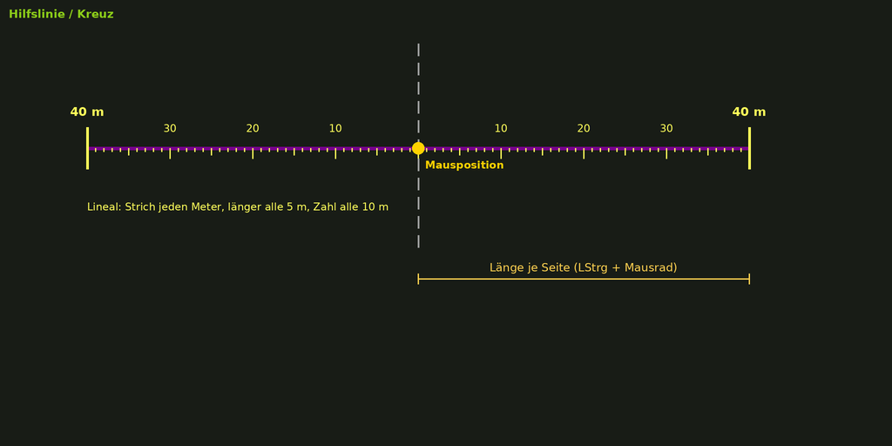

### 4. Gerade auf Hilfslinie

Erster Klick = Start, zweiter Klick = Ende, beide werden auf die Hilfslinie gesetzt. Die Punkte werden gleichmäßig verteilt (Abstand höchstens „max. Punktabstand“).

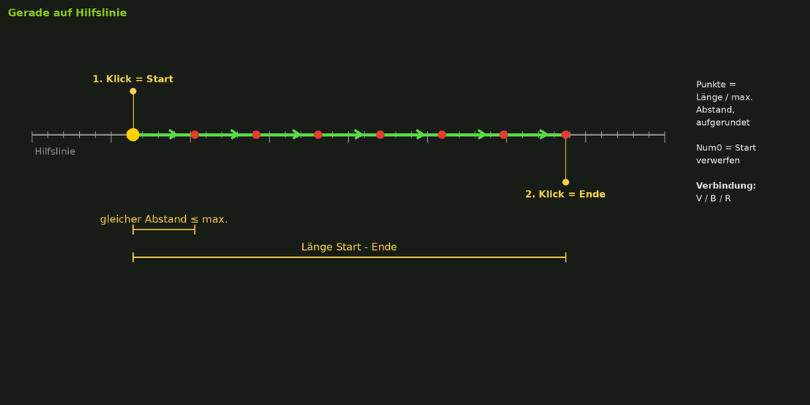

### 5. Bogen

Ein Bogen, der die letzten zwei Hilfslinien berührt. Die Maus wählt Ecke und Größe.

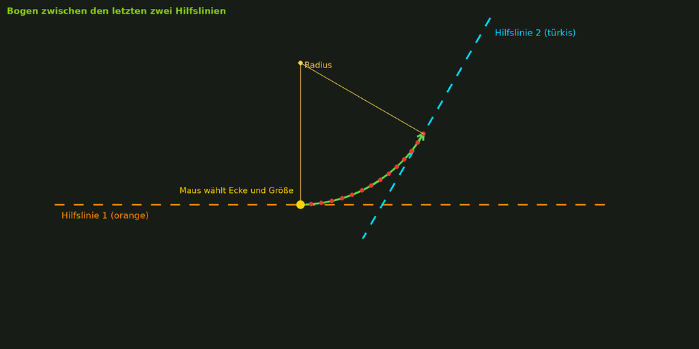

### 6. Verzweigung

Zulauf, Abzweige nach links und/oder rechts (jeder mit eigenem Winkel, Radius und Beginn), wahlweise geradeaus weiter. Zum Zusammenführen gibt es die Zuführung (7).

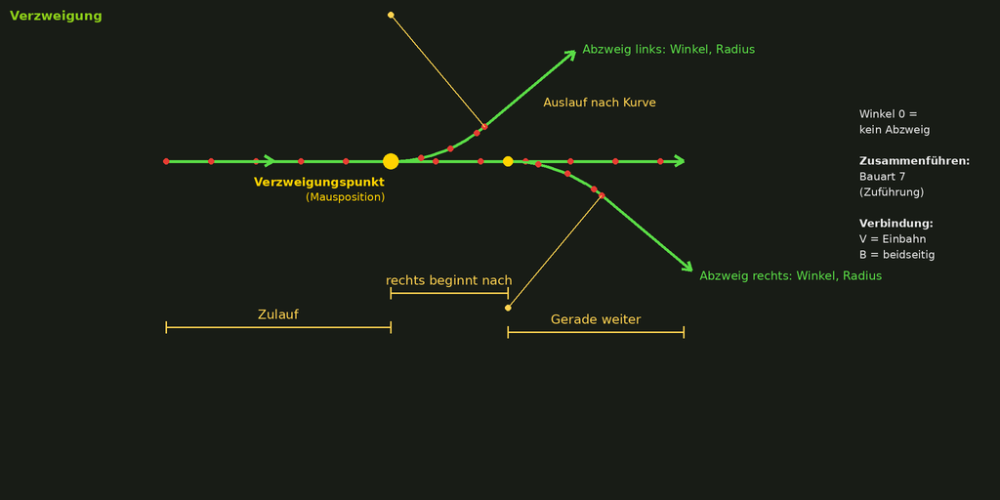

### 7. Zuführung

Das Gegenstück: Strecken von links und/oder rechts hinten laufen auf eine Linie zusammen.

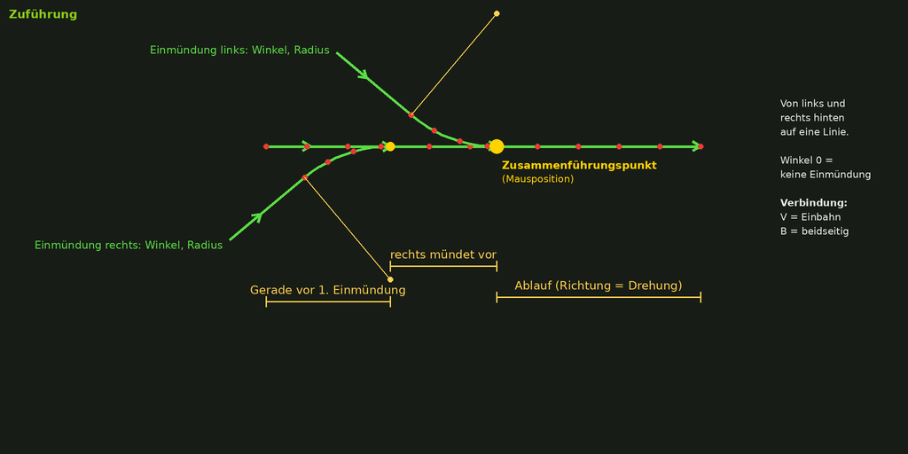

### 8. Auswählen / Verschieben

Bestehende AD-Punkte mit dem Kasten auswählen, verschieben, kopieren, löschen.

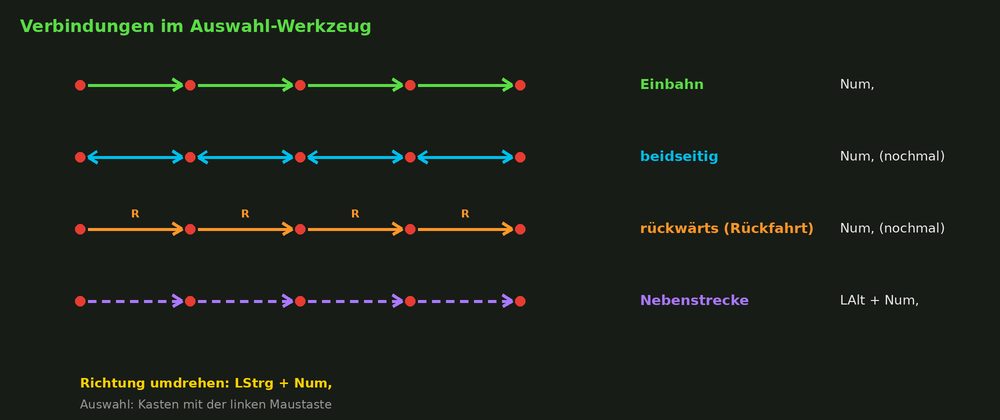

## Tasten beim Platzieren

Im Spiel steht dasselbe im Panel links oben (Num- blendet es ein und aus).

### Für alle Bauarten

| Was du machen willst | So geht's |
|---|---|
| Bauen | Linksklick (der Baukasten bleibt aktiv) |
| Baukasten beenden | Ende |
| Drehen | LUmschalt + Mausrad oder `,` / `.` |
| Fein drehen | LUmschalt + LAlt + Mausrad (mit LStrg noch feiner) |
| Fein verschieben | Num8 / Num2 / Num4 / Num6 |
| Position festhalten | Num5 |
| An einen AD-Punkt setzen | Num0 |
| Andere Bauart | Num1, dann Zahl oder Klick |
| Draufsicht an / aus | Num+ |
| Draufsicht zurück zu dir / zum Fahrzeug | LStrg + Num+ |
| Draufsicht bewegen / drehen | W A S D / Leertaste halten + Maus ziehen |
| Kamera zoomen / umsehen | Mausrad / mittlere Maustaste oder Num/ |
| AutoDrive-Netz zeigen | Num* |
| Selbst mit AutoDrive bearbeiten | kurzer Rechtsklick oder Num Enter |
| Letzte Strecke rückgängig | LStrg + LAlt + Z |
| Einstellungen der Bauart | LStrg + LAlt + B |
| Hilfe / Hilfskreise ein / aus | Num- / H |

### 1. Rückfahr-Bucht

| Was du machen willst | So geht's |
|---|---|
| Kurven größer / kleiner | LStrg + Mausrad |
| Mehr / weniger Punkte in den Kurven | LAlt + Mausrad |
| Buchten automatisch ins Fahrsilo setzen | Maus ins Silo (nahe der Einfahrt), dann Num9 |
| Maus an der ersten Bucht / in der Mitte | Num3 |
| Zu- oder Abfahrt an eine Hilfslinie anlegen | LStrg + Linksklick auf die Kurve, dann auf die Linie |
| Zu- oder Abfahrt auf die andere Seite | LAlt + Linksklick auf die Kurve |

### 2. Freie Kurve und 5. Bogen

| Was du machen willst | So geht's |
|---|---|
| Kurve größer / kleiner | LStrg + Mausrad |
| Mehr / weniger Punkte | LAlt + Mausrad |
| Fahrtrichtung umdrehen | Num3 |
| Einbahn / beidseitig / rückwärts | Num, |
| Bogen: Ecke und Größe wählen | Maus bewegen |

### 3. Hilfslinie

| Was du machen willst | So geht's |
|---|---|
| Hilfslinie setzen | Linksklick |
| Linie länger / kürzer | LStrg + Mausrad |
| Linie seitlich verschieben | LAlt + Mausrad |
| Parallel zu Linie, Silowand oder Gebäude | LStrg + Linksklick daran |
| Linie löschen / zurückholen | Entf / LUmschalt + Entf |
| Alle Hilfslinien löschen | LStrg + LAlt + L |

### 4. Gerade auf Hilfslinie

| Was du machen willst | So geht's |
|---|---|
| Start setzen | erster Linksklick nahe der Hilfslinie |
| Ende setzen und bauen | zweiter Linksklick |
| Abstand der Punkte | LAlt + Mausrad |
| Start verwerfen | Num0 |

### 6. Verzweigung und 7. Zuführung

| Was du machen willst | So geht's |
|---|---|
| Kurven größer / kleiner | LStrg + Mausrad |
| Mehr / weniger Punkte | LAlt + Mausrad |
| Einbahn / beidseitig | Num, |
| An einen AD-Punkt anschließen | Num0 |
| Abzweig an eine Hilfslinie anlegen | LStrg + Linksklick auf den Abzweig, dann auf die Linie |
| Einen Abzweig weglassen / zurückholen | LAlt + Linksklick auf die Seite |

## Hilfslinien

Hilfslinien helfen beim genauen Bauen. Nur du siehst sie, AutoDrive baut daraus nichts.

- Linie setzen: Bauart 3, Linksklick. Die Linie hat ein Lineal mit Metern.
- Parallel ausrichten: LStrg + Linksklick an eine andere Hilfslinie, eine Silowand oder eine Gebäudekante. Die neue Linie dreht sich parallel dazu.
- Abstand sehen: Solange die Linie parallel ist, zeigt eine gelbe Linie den Abstand.
- Seitlich verschieben: LAlt + Mausrad. Jedes neue Drücken von LAlt macht die Schritte kleiner: 1 m, 0,5 m, 0,1 m, 0,01 m.
- Löschen: Entf löscht die Linie bei der Maus, LUmschalt + Entf holt sie zurück, LStrg + LAlt + L löscht alle.
- Die Linien bleiben im Spielstand gespeichert. Die letzten zwei (orange und türkis) braucht der Bogen.

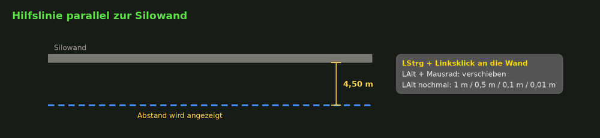

## An Hilfslinien anlegen

Geht bei Rückfahr-Bucht (Zu- und Abfahrt), Verzweigung und Zuführung:

1. LStrg + Linksklick auf die Kurve oder den Abzweig.
2. LStrg + Linksklick auf die Hilfslinie.
3. Fertig: Die Kurve beginnt bzw. endet jetzt genau auf der Linie.

LStrg + Num0 hebt das wieder auf. Statt Linksklick geht auch eine Seitentaste der Maus.

## AutoDrive-Punkte bearbeiten

Bauart 8 (Auswählen / Verschieben), am besten in der Draufsicht:

| Was du machen willst | So geht's |
|---|---|
| Punkte auswählen | linke Maustaste halten und Kasten ziehen |
| Mehr Punkte dazu / Punkte abwählen | Kasten mit LUmschalt / mit LStrg |
| Einen Punkt auswählen | Linksklick auf den Punkt |
| Auswahl aufheben | Num0 |
| Auswahl verschieben | ausgewählten Punkt mit der linken Maustaste ziehen |
| Fein verschieben | Num8 / Num2 / Num4 / Num6 |
| Nur entlang / quer zur Hilfslinie schieben | Num3 |
| Auswahl gerade auf die Hilfslinie legen | Num7 (Num9: dazu gleichmäßig verteilen) |
| Einbahn / beidseitig / rückwärts | Num, |
| Fahrtrichtung umdrehen | LStrg + Num, |
| Haupt- / Nebenstrecke | LAlt + Num, |
| Punkte einer Kurve ändern | Kurve wählen, LAlt + Mausrad, dann Linksklick |
| Gerade zwischen zwei Punkten | 2 Punkte wählen, Num/, dann Linksklick |
| AD-Ziel setzen / umbenennen / löschen | 1 Punkt wählen, Num5 |
| Auswahl kopieren | LStrg + C, Linksklick fügt ein, Num0 = fertig |
| Auswahl löschen | Entf, dann nochmal Entf – **nicht rückgängig zu machen** |
| Rückgängig | LStrg + LAlt + Z |

Tipp: Bei einer langen Strecke reicht es, den ersten und den letzten Punkt zu wählen. AD-Ziele werden nicht mitkopiert.

## Draufsicht und AutoDrive bearbeiten

- Der Baukasten startet in der Draufsicht über dir bzw. deinem Fahrzeug.
- Kurzer Rechtsklick oder Num Enter: Bauen pausiert, du bearbeitest mit dem normalen AutoDrive-Editor. Num Enter bringt dich zurück.
- AutoDrive bearbeitet mit der Maus nur, wenn du in einem Fahrzeug sitzt, das AD-HUD an ist und der Editor auf „erweitert“ steht (Num/). Das Panel zeigt dir, was fehlt.

## Gut zu wissen

- Mehrspieler: Der Mod muss auf dem Server **und** bei allen Spielern in derselben Version sein.
- Neue Strecken werden nur dort mit dem AD-Netz verbunden, wo du Num0 benutzt. Den Rest verbindest du im AutoDrive-Editor.
- Rückfahr-Bucht: Dort, wo das Rückwärtsfahren beginnt, darf keine andere Strecke abzweigen.
- Deutsche Tastatur: Rückgängig geht mit LStrg + LAlt + Z oder Y.
- Texte und Bilder gibt es auf Deutsch und Englisch.

## Unterstützen

Der Mod ist kostenlos. Wenn er dir Zeit spart und du etwas zurückgeben möchtest, freue ich mich über eine kleine Spende – ganz freiwillig.

## Fehler und Wünsche

Bitte als [Issue](../../issues) melden – am besten mit Screenshot und der `log.txt`.

## Ersteller

Toneslin
